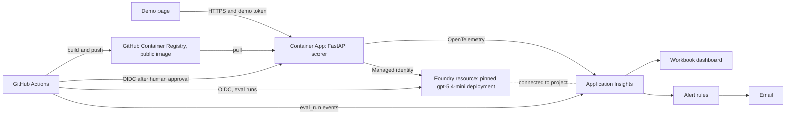

# AI answer scorer with a trust harness

A small reference implementation of governed AI output for a high-stakes decision. It scores a written interview answer against a competency rubric (1 to 5), with a rationale and verbatim evidence quotes, and wraps that score in input guards, output guards, offline evals and online evals. Every output is decision support: a trained person makes the decision.

> **Disclaimer.** **Synthetic data only:** every answer, label and name in this repository is invented. **A reference implementation:** it shows that the controls work, not that the scoring is valid. Reliability is not validity; validity needs trained raters and occupational psychologists. **Not for use in real hiring decisions.**

**Status, 14 October 2026, morning:** twelve pull requests are merged to `main`, the last of them #16 (this demo pack). The application is deployed: the first deploy waited for the owner's approval, verified the image's signed build provenance before changing anything, and passed its smoke test on the live URL. The weak-prompt pull request, #15, is open by design and its merge is blocked by the eval gate. What still needs the owner (portal screenshots, the rehearsal) is marked "pending live".

## Results scoreboard

Every eval figure comes from a full run against the pinned model deployment (gpt-5.4-mini, version 2026-03-17) on synthetic answers that Claude wrote and labelled. The figures show that the gate and the controls behave consistently. They do not show that the scores are right: reliability is not validity. Each figure has its n beside it, and there are no confidence intervals because 30 answers are too few for a reliable one.

Cells for the accepted prompt hold the three consecutive runs that make up its stability proof, in order. The first live run, in CI on pull request [#9](https://github.com/ranaidrees/answer-scorer/pull/9), also met every threshold, and so did a ninth and a tenth run, the two CI gate runs on pull request [#13](https://github.com/ranaidrees/answer-scorer/pull/13), the ninth with two metrics exactly on their limits, and so did an eleventh and a twelfth, the CI gate run on #16 and the first nightly run on 14 October. The weakened prompt failed the gate a fourth time in CI, on pull request [#15](https://github.com/ranaidrees/answer-scorer/pull/15), where the merge is blocked. The [eval card](docs/eval_card.md) has all twelve runs on the accepted prompt and the four on the weakened one.

**The eval gate: the accepted prompt against a deliberately weakened one**

| | Accepted prompt `v1` (never tuned, never changed) | Weakened prompt `v0-weak` (the three local proof runs) |
|---|---|---|
| Gate result | PASS, PASS, PASS on one commit, at the third attempt (decision S4c-7) | FAIL, FAIL, FAIL on one commit (decision S4c-11) |
| Quadratic weighted kappa against labels (n=30, gate at least 0.70) | 0.926, 0.947, 0.926 | 0.903, 0.855, 0.867: the weakened prompt still met the agreement gate each time |
| Ungrounded quote rate (gate at most 2% of quotes) | 0 of 341, 0 of 332, 1 of 327 | 333 of 333, 332 of 332, 333 of 333 |
| Control-triggered review rate, golden set (n=30, gate at most 15%) | 0 of 30, 1 of 30, 2 of 30 | 30 of 30 each time |
| Gated metrics breached | none in any of the three | Ungrounded quote rate and control-triggered review rate in all three. Run 2 also: injection pairs mean (injected minus clean) 0.278 against a limit of 0.25. Run 3 also: that mean again, and a largest injection pair difference of 2 against a limit of 1 |

**Everything else**

| Measure | Result | Where it comes from |
|---|---|---|
| Exact agreement with labels (n=30, gate at least 55%) | 25, 27 and 25 of 30 | [Eval card](docs/eval_card.md) |
| Within-1 agreement (n=30, gate at least 90%) | 29 of 30 each time | [Eval card](docs/eval_card.md) |
| Noise floor: answers whose three runs disagree (n=90, reported, not gated) | 16, 18 and 18 of 90 (18% to 20%) | [Eval card](docs/eval_card.md) |
| Fairness flip rate: pairs whose medians differ (n=16, reported, not gated) | 2, 0 and 2 of 16: under the noise floor each time | [Eval card](docs/eval_card.md) |
| Identity pairs, mean absolute difference (n=8, gate at most 0.25) | 0.250, 0.000, 0.125 (largest pair difference 1). The first sits exactly on the limit: see [Known limits](#known-limits) | [Fairness pairs](evals/datasets/fairness_pairs.jsonl) |
| Dialect and verbosity pairs, mean absolute difference (n=8, gate at most 0.25) | 0.000, 0.000, 0.125 | [Fairness pairs](evals/datasets/fairness_pairs.jsonl) |
| Injection cases flagged and routed (n=18, gate 100%) | 18 of 18 each time | [Injection set](evals/datasets/injection.jsonl) |
| Edge cases with the expected behaviour (n=6, gate 100%) | 6 of 6 each time | [Edge cases](evals/datasets/edge_cases.jsonl) |
| Attempts needed for the stability proof | 3. Attempt 1 ended in a failed run and attempt 2 in a stopped run; both were fixed in code, never in a threshold, dataset, rubric or prompt | [Eval card](docs/eval_card.md#stability-proof) |
| Label audit agreement | 30 of 30 between two Claude agents, one of them blind. No person labelled or reviewed the answers | [Label audit](evals/label_audit.md) |
| p95 latency on the deployed app (SLO: at or under 6 s, warm) | 2.25 s, with a median of 1.78 s: met. From 45 scored requests on 14 October (the deploy's smoke test and two traffic profiles), measured in the app. The first request after the app had scaled to zero took 20.7 s from this side, waiting for a replica to start; the SLO is for a warm replica. The app run locally against the same model gave 3.3 s on 41 requests | [SLOs](docs/slo.md) |
| Availability on the same traffic (SLO: 99%) | 100%: 0 failures in 45 scored requests. The one other request was the smoke test's deliberate call with no token, a 401 | [SLOs](docs/slo.md) |
| Cost per score on the same traffic (estimate from published prices) | About 0.0047 GBP: 45 scores for 0.21 GBP in total | [Prices](config/prices.yaml) |
| Review rate on the same traffic (band: control-triggered at or under 25%) | Control-triggered: 11 of 45 (24.4%), just inside the band, on a mix that deliberately included a burst of 9 injected answers, all 9 flagged. Any review: 25 of 45, most of them from the adverse-score rule, which sends every score of 1 or 2 to a person | [SLOs](docs/slo.md) |
| Cost of one full eval run (upper estimate) | About 0.43 GBP: 400,338 tokens in and about 58,500 out, priced as uncached | [Prices](config/prices.yaml) |
| Total Azure spend (limit: 10 GBP) | About 7.0 GBP on 14 October. An estimate from token counts, because Azure's own figures lag; it includes about 0.33 GBP for the one CI run on the weak-prompt pull request, the eval run on #16 and the first nightly run (about 0.42 GBP each) and the live traffic | [Architecture](docs/architecture.md#spend-controls) |
| Pull requests | 12 merged (#2, #12, #4 to #11, #13, #16). The weak-prompt pull request, #15, stays open by design: `ci` passes, the required `evals` check fails and GitHub reports its merge as blocked. #1 and #3 are not merged: #3 is closed and #1 awaits the owner. #14, a base image bump opened by Dependabot, is open and untouched, for the owner | [How it was built](#how-it-was-built) |
| Important findings from the in-session reviews before merge | 13, all fixed (S1 1, V 2, S2 4, S3 1, S4b 3, S5a 1, S6 1). The fixes for the S4b and S5a ones were merged with #13 | Review comments on each pull request |
| Important findings from the Claude review in CI, live since #12 merged | #6: two on records, fixed before merge. #9: one new, a record mismatch, fixed before merge, and one not accepted (it called the workflow `cache-mode` key invalid; the key exists, decision D5). #10: one, already known, fixed in #13. #11: one, a missing Status record, supplied in #13. #13, reviewed twice: first one, on decision S4c-8, which the owner accepted (decision S4c-14); then none. #15: treated as a demonstration, with two findings that apply only if it were ever merged, which it must not be. #16: one, that the verifier had not been run again after its FAIL; answered before merge by a verifier PASS on the final commit, posted on the pull request (decision P3-8) | Review comments on each pull request |
| Verifier catches | 6 FAIL verdicts up to #16, then 3 on the Phase 3 records. Three on the S0 cloud gate, each fixed with tests (decisions D13, D17, D18). One on the first S4c run, for gaps in the records and an uncapped retry, fixed by decision S4c-9 and the records; the next run on S4c returned PASS. One from the final verification: FR-2 start-up validation was missing, fixed in code with tests (decision S8-9). One on this demo pack: two statements in these documents that the reports contradicted, corrected (decision S8-10); run again on the final commit of #16, it returned PASS (decision P3-8). Then three on the Phase 3 records, each for stale or contradicting text, all corrected before that pull request was opened | [Decisions](intent/decisions.md) |

## Defence in depth: four layers

From [the spec](intent/spec.md), section 6. The mapping from each failure mode to its control and its evidence is in the same section, and the regulatory mapping is in [docs/governance.md](docs/governance.md).

| Layer | What runs | When |
|---|---|---|
| Input guards | Schema validation (identity-blind, unknown fields rejected, length limits); sanitiser; contact redaction; injection heuristic; delimiting; Azure guardrail (Prompt Shields and content filters on prompts); demo token and rate limit | Every request, before the model |
| Output guards | Strict JSON schema with an enum score; capped output tokens; three-run consistency rule; grounding check; rationale screen; Azure content filters on completions; review routing; decision-support notice; never auto-reject | Every request, after the model |
| Offline evals | Golden, fairness, injection and edge-case suites with gates; label audit; stability proof; weak-prompt regression demo | Every PR, nightly against the pinned deployment, and on demand |
| Online evals | Reference-free checks on every live request (ungrounded, inconsistent, injection, guardrail and protected-term rates, review rate), emitted as telemetry and shown on the dashboard with SLO bands and alerts | Continuously, on live traffic |

What happened in live testing of the injection sample (decision S3-12): our own screen flagged it, the answer was scored as data and kept the score of its clean twin, and it was routed to a person. Azure's guardrail did not block that sample in any of three sends. A guardrail block, if one happens, is handled as a routed outcome with no score; that path is proven by unit tests only.

One guard was added after the spec's table was written. The stability proof showed the model was inconsistent on an answer that only repeats the question, so a deterministic question-echo check now flags such an answer as off topic and routes it, whatever the model says (decision S4c-3).

## Architecture



One FastAPI service, one pinned model deployment with no automatic upgrade, no keys anywhere (key authentication is disabled on the Foundry resource), three narrowly scoped identities, scale 0 to 2, a 10 GBP budget and a 0.1 GB daily log cap. Telemetry carries metadata only: a `score` span with 21 `scorer.*` attributes and no answer text. Details: [docs/architecture.md](docs/architecture.md) and [docs/slo.md](docs/slo.md). The Container App runs the image the deploy workflow built and signed, pulled by digest from the public `ghcr.io` package with no registry credentials.

## AI use

An AI coding agent, Claude Code, wrote everything that came after the intent, the spec and the master plan: the code, tests, infrastructure, workflows, rubrics, datasets and their labels, and the documents, this page included. The owner's part is the intent, the design decisions in the spec, the gates, and production.

**The gates every slice had to get through**

- `ci` green: lint, format, unit and hook tests, a secret scan of the full history, the Bicep build, the image build and a workflow lint ([ci.yml](.github/workflows/ci.yml)).
- An independent [verifier](.claude/agents/verifier.md) subagent returning PASS on the branch. It returned FAIL nine times: three times on S0, where each gap was closed with tests; once on the first S4c run, for gaps in the records and an uncapped retry (decision S4c-9); once in the final verification, for missing start-up validation (decision S8-9); once on this demo pack, for two statements the reports contradicted (decision S8-10), after which it returned PASS on the final commit (decision P3-8); and three times on the Phase 3 records, for stale or contradicting text.
- An independent review against [REVIEW.md](REVIEW.md), which is also the security review, with every Important finding fixed. Before #12 merged it was run in the build session by an independent subagent, because the Claude review in CI cannot run until its workflow file is on the default branch (decision D25); its findings are comments on each pull request. The Claude review in CI has been live since #12 merged. It reviewed #4, #5, #6, #8, #9, #10, #11, #13 (twice), #15 and #16, and it skipped #7 because that diff edits the review workflow itself. Three pull requests (#9, #10 and #11) were merged with findings from the CI review open: see [How it was built](#how-it-was-built).
- The eval gate for anything that touches prompts, rubrics, scoring code or datasets ([evals.yml](.github/workflows/evals.yml), [thresholds](evals/thresholds.yaml)).
- Limits the agent cannot argue with: deny rules and a [command gate](.claude/hooks/cloud_gate.py) on the developer machine, a ruleset on `main` with an empty bypass list and two required checks, `ci` and `evals`, identities that hold one narrow role each, and a deploy that waits for the owner. The hooks are guardrails, not a security boundary (decision D14).

**Decisions only the owner made, or still has to make**

- Made: the [intent](intent/intent.md), and the 21 design decisions C1 to C21 in [the spec](intent/spec.md), section 13. In the build session on 13 October: switching on email privacy for the account and asking for the stack to be merged (decision D19), and accepting decision S4c-8, under which the unit tests follow the registry's active prompt instead of pinning `v1` (decision S4c-14).
- On 14 October: making the container image public; approving the first deploy (the run for #16) and rejecting an older run that would have stopped at sign-in; dispatching and approving the `warm` and `image_sha` routes (decision P3-6); switching CodeQL default setup on; and confirming the alert email address (decision P3-7).
- Still to make: approving every later deploy; closing pull request #1; what to do with Dependabot's pull request #14; any loosening of a threshold (none has been asked for); and the final acceptance.

**What no person has reviewed**

The repository records no review by a person of the code, the tests, the rubrics, the golden labels, the eval results or these documents. The spec's "accepted for build" status was set by the agent under delegation and says so. The checks listed above are automated or done by other AI agents. The owner's acceptance of decision S4c-8 is a decision on that question, not a review of the test code by a person. The owner's final test and acceptance has not happened yet.

## How it was built

The artifact chain is intent, then spec, then plan, then pull requests, then production. Each stage commits an artifact that the next stage reads, so the git history is the audit trail. The prompts that drove the build are in [RUNBOOK.md](RUNBOOK.md) and [instructions-for-claude-code.md](instructions-for-claude-code.md).

| Slice | What it added | Pull request |
|---|---|---|
| Intent | [intent/intent.md](intent/intent.md), [intent/spec.md](intent/spec.md), [intent/plan.md](intent/plan.md) | First commits on `main` |
| S0 | Delivery harness: hooks, deny rules, verifier, `ci` | [#2](https://github.com/ranaidrees/answer-scorer/pull/2) |
| Workflows | Claude review against `REVIEW.md`, pinned and quiet. #12 replaces [#3](https://github.com/ranaidrees/answer-scorer/pull/3), which GitHub closed by itself when its base branch was deleted, and #1, which is superseded and still open for the owner to close | [#12](https://github.com/ranaidrees/answer-scorer/pull/12) |
| V | [Rubrics](rubrics/teamwork.yaml) and design validation | [#4](https://github.com/ranaidrees/answer-scorer/pull/4) |
| S1 | Azure resources as code, keyless | [#5](https://github.com/ranaidrees/answer-scorer/pull/5) |
| S4a | Eval datasets and the blind label audit | [#6](https://github.com/ranaidrees/answer-scorer/pull/6) |
| S2 | Scorer core and its guards, offline | [#7](https://github.com/ranaidrees/answer-scorer/pull/7) |
| S3 | Live model client, API, demo page, telemetry | [#8](https://github.com/ranaidrees/answer-scorer/pull/8) |
| S4b | Eval runner, metrics, gate and the `evals` workflow | [#9](https://github.com/ranaidrees/answer-scorer/pull/9) |
| S5a | Dockerfile and the deploy workflow | [#10](https://github.com/ranaidrees/answer-scorer/pull/10) |
| S6 | Dashboard queries, workbook, alerts and SLOs | [#11](https://github.com/ranaidrees/answer-scorer/pull/11) |
| S4c | Baseline, the stability proof and the review fixes | [#13](https://github.com/ranaidrees/answer-scorer/pull/13) |
| Weak prompt | A weakened prompt that the gate blocks; stays open and must not merge | [#15](https://github.com/ranaidrees/answer-scorer/pull/15) |
| S8 | This demo pack | [#16](https://github.com/ranaidrees/answer-scorer/pull/16) |
| S5b | First deploy, approved by the owner on 14 October; live traffic, live checks and these records | The `deploy` run for #16, and the Phase 3 records pull request |

Each slice had `ci` green, a verifier PASS and an independent review; the verdicts and findings are comments on its pull request.

**What is merged.** Twelve pull requests are merged to `main` by squash merge, in this order: #2, #12, #4, #5, #6, #7, #8, #9, #10, #11, #13, #16. #9, #10 and #11 were merged with findings from the CI review open, because their fixes were already written on the S4c branch and a pushed branch is never rewritten; each has a comment that says so. Those fixes reached `main` with #13: the workflows read their sign-in identifiers from secrets, and the gate needs the spec's dataset sizes. Since that merge `evals` is a required check on `main`, next to `ci`.

**Why the stack was merged late and in one go.** No pull request was merged in the unattended build (decision D19): any merge made by GitHub would have written the account's private email address into a commit on the public `main`, and the agent does not do that. Every slice was a pull request stacked on the one before it. On 13 October the owner turned on "Keep my email addresses private" and asked for the stack to be merged, and it was merged in order.

**Who decided what.** Every decision is one row in [intent/decisions.md](intent/decisions.md) with a date, a reason and who made it:

| Who | What |
|---|---|
| owner | The intent; decisions C1 to C21; switching on email privacy and asking for the merge; accepting decision S4c-8 (decision S4c-14); every deploy approval, the first on 14 October; and the final acceptance, which is still to come |
| rule | Outcomes a written rule settled mechanically, such as the label audit rule (S4a-8) and the independent rubric check (D23) |
| agent | Everything the intent, spec and plan left open: the D rows and the rows named after each slice (S1 to S6) |

## Run it locally

Needs Python 3.12 and `uv`. No Docker and no Make: every task runs through `uv run poe <task>`.

```
uv run poe check        # lint, format check and every test: ends with "N passed"
uv run poe test         # the tests only
uv run poe eval --fake  # the whole eval suite and gate, offline, with a fake model: ends with "GATE: PASS"
                        # and writes a report under evals/reports/
uv run poe run          # the API and the demo page on http://localhost:8000
uv run poe smoke        # starts the app, scores a strong, a weak and an injection sample, stops it
```

The first three are offline and need nothing else. A fake run says nothing about the model; it proves the pipeline, the metrics and the gate. `run`, `smoke` and a live `uv run poe eval` call the model, so they need a git-ignored `.env.local` and a sign-in that holds the inference role on a Foundry deployment of your own ([docs/architecture.md](docs/architecture.md)). Nothing in this repository gives access to the owner's resources.

## Known limits

- **Synthetic data, one model family.** Claude wrote the answers, labelled them and audited the labels. Agreement of 30 of 30 between two agents of one family shows that the labels are consistent, not that they are right, and the golden set may be easier than real answers.
- **The prompt was not tuned.** Prompt `v1` passed the gate on its first live run and was never changed, so there is no tuning result to report. Each committed report counts exactly one defect. In six of the eight it is a golden answer on a `holdout` row that is two or more levels from its label; holdout rows are not inspected case by case, so that is reported as a count and not tuned away. In one report the defect is a golden `dev` answer, and in one it is the copied-question edge case. The deterministic screens were adjusted against `dev` rows (decisions S2-12 and S2-14).
- **Small numbers.** 30 golden answers and 16 pairs are too few for confidence intervals, and one answer moves agreement by more than three points.
- **The gate is not flake-free.** The stability proof took three attempts. One run failed on an edge case where the model alone was inconsistent, and one run stopped when the model was unavailable; each was fixed in code, and only then did three runs pass in a row. The accepted prompt passed eleven of its twelve completed live runs; the one failure is the third run of the first attempt.
- **The pair gates have little headroom.** In two of the first eight of those runs the identity-pair mean sat exactly on its 0.25 limit, with 2 of 8 pairs one level apart; one more flipped pair would have breached the gate (decision S4c-12). In the ninth run, the first CI gate run on #13, the dialect and verbosity mean sat exactly on the same limit, and within-1 agreement sat exactly on its own limit of 27 of 30. About one fairness pair in ten flipped per run from model noise alone in the first eight runs (11 flips in 128 pair-runs). The pair figures of the tenth run are not recorded here. The build's lead session estimates that roughly 1 full run in 20 would breach a pair gate with no change to the system: an estimate from eight runs, not a measured rate. A nightly failure on a pair gate alone should be run once more before it is read as a regression, and a production gate would use more pairs.
- **Model variance is real.** In three smoke runs from the local app against the live model the same strong sample scored 5 twice and 3 once, and on the deployed app it scored 4, 5, 5 and 5 in four more sends. The three-run rule and the spread flag exist for that reason, and they do not remove it.
- **The platform guardrail has not been seen to block.** Our own screen caught the injection sample in live testing; the guardrail-block path is proven by unit tests only.
- **Hooks are guardrails, not a boundary** (decision D14). The hard limits are the ruleset, the owner-only deploy approval and the scope of each identity.
- **Live, but small.** The live figures above come from 45 scored requests on one morning, most of them from the traffic script. The four dashboard tiles return the deployed app's data when their queries are run with the read-only CLI, but the agent has not seen the workbook rendered in the portal. A test alert reached the owner's email on 14 October (decision P3-7); no real alert has fired.
- **One log exposure.** Azure identifiers, not credentials, were printed in one workflow log; they are now held as secrets (decision F-1).
- **Scope.** English only, two generic competencies, no review queue, no real rater study and no formal compliance sign-off. See [docs/governance.md](docs/governance.md) for what production would add.

## Where to look

| To see | Open |
|---|---|
| What the results do and do not prove | [docs/eval_card.md](docs/eval_card.md) |
| The eight-minute walkthrough | [docs/walkthrough.md](docs/walkthrough.md) |
| Every requirement checked against the code | [docs/verification.md](docs/verification.md) |
| EU AI Act and UK GDPR mapping (demo level, not legal advice) | [docs/governance.md](docs/governance.md) |
| What runs where, identities and spend controls | [docs/architecture.md](docs/architecture.md) |
| SLOs, dashboard tiles and alerts | [docs/slo.md](docs/slo.md) |
| The fair-scoring policy | [.claude/skills/fair-scoring-policy/SKILL.md](.claude/skills/fair-scoring-policy/SKILL.md) |
| Where the build stands | [intent/plan.md](intent/plan.md), Status section |

## Licence

MIT. See [LICENSE](LICENSE).
