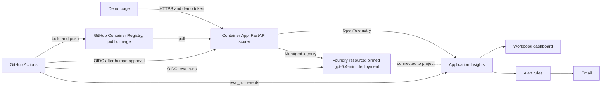

# AI answer scorer with a trust harness

A small reference implementation of governed AI output for a high-stakes decision. It scores a written interview answer against a competency rubric (1 to 5), with a rationale and verbatim evidence quotes, and wraps that score in input guards, output guards, offline evals and online evals. Every output is decision support: a trained person makes the decision.

> **Disclaimer.** **Synthetic data only:** every answer, label and name in this repository is invented. **A reference implementation:** it shows that the controls work, not that the scoring is valid. Reliability is not validity; validity needs trained raters and occupational psychologists. **Not for use in real hiring decisions.**

**Status, 13 October 2026:** built and checked as a stack of open pull requests. Nothing is merged to `main` yet and the application is not deployed yet, so there is no live URL. Anything that needs one is marked "pending live", and a figure that has not been measured yet is marked PENDING.

## Results scoreboard

Every eval figure comes from a full run against the pinned model deployment (gpt-5.4-mini, version 2026-03-17) on synthetic answers that Claude wrote and labelled. The figures show that the gate and the controls behave consistently. They do not show that the scores are right: reliability is not validity. Each figure has its n beside it, and there are no confidence intervals because 30 answers are too few for a reliable one.

Cells for the accepted prompt hold the three consecutive runs that make up its stability proof, in order. The first live run, in CI on pull request [#9](https://github.com/ranaidrees/answer-scorer/pull/9), also met every threshold; the [eval card](docs/eval_card.md) has all eight runs.

**The eval gate: the accepted prompt against a deliberately weakened one**

| | Accepted prompt `v1` (never tuned, never changed) | Weakened prompt `v0-weak` |
|---|---|---|
| Gate result | PASS, PASS, PASS on one commit, at the third attempt (decision S4c-7) | [[PENDING: gate results of the three weak-prompt runs]] |
| Quadratic weighted kappa against labels (n=30, gate at least 0.70) | 0.926, 0.947, 0.926 | [[PENDING: weak-prompt kappa in each of three runs]] |
| Ungrounded quote rate (gate at most 2% of quotes) | 0 of 341, 0 of 332, 1 of 327 | [[PENDING: weak-prompt ungrounded quote rate in each of three runs]] |
| Control-triggered review rate, golden set (n=30, gate at most 15%) | 0 of 30, 1 of 30, 2 of 30 | [[PENDING: weak-prompt control-triggered review rate in each of three runs]] |
| Gated metrics breached | none in any of the three | [[PENDING: which gated metrics the weak prompt breaches]] |

**Everything else**

| Measure | Result | Where it comes from |
|---|---|---|
| Exact agreement with labels (n=30, gate at least 55%) | 25, 27 and 25 of 30 | [Eval card](docs/eval_card.md) |
| Within-1 agreement (n=30, gate at least 90%) | 29 of 30 each time | [Eval card](docs/eval_card.md) |
| Noise floor: answers whose three runs disagree (n=90, reported, not gated) | 16, 18 and 18 of 90 (18% to 20%) | [Eval card](docs/eval_card.md) |
| Fairness flip rate: pairs whose medians differ (n=16, reported, not gated) | 2, 0 and 2 of 16: under the noise floor each time | [Eval card](docs/eval_card.md) |
| Identity pairs, mean absolute difference (n=8, gate at most 0.25) | 0.250, 0.000, 0.125 (largest pair difference 1). The first sits exactly on the limit: see [Known limits](#known-limits) | [Fairness pairs](evals/datasets/fairness_pairs.jsonl) |
| Dialect and verbosity pairs, mean absolute difference (n=8, gate at most 0.25) | 0.000, 0.000, 0.125 | [Fairness pairs](evals/datasets/fairness_pairs.jsonl) |
| Injection cases flagged and routed (n=18, gate 100%) | 18 of 18 each time | [Injection set](evals/datasets/injection.jsonl) |
| Edge cases with the expected behaviour (n=6, gate 100%) | 6 of 6 each time | [Edge cases](evals/datasets/edge_cases.jsonl) |
| Attempts needed for the stability proof | 3. Attempt 1 ended in a failed run and attempt 2 in a stopped run; both were fixed in code, never in a threshold, dataset, rubric or prompt | [Eval card](docs/eval_card.md#stability-proof) |
| Label audit agreement | 30 of 30 between two Claude agents, one of them blind. No person labelled or reviewed the answers | [Label audit](evals/label_audit.md) |
| p95 latency (SLO: at or under 6 s, warm) | [[PENDING: p95 latency from warm traffic on the deployed app]]. Local proof only so far: 7 scores, median 2.2 s (decision S3-13) | [SLOs](docs/slo.md) |
| Cost per score (estimate from published prices) | About 0.004 GBP on ten local requests (decision S6-6). [[PENDING: cost per score from live traffic]] | [Prices](config/prices.yaml) |
| Review rate on live traffic (band: at or under 25%) | [[PENDING: control-triggered review rate on live traffic]] | [SLOs](docs/slo.md) |
| Cost of one full eval run (upper estimate) | About 0.43 GBP: 400,338 tokens in and about 58,500 out, priced as uncached | [Prices](config/prices.yaml) |
| Total Azure spend (limit: 10 GBP) | [[PENDING: total spend at the freeze]] | [Architecture](docs/architecture.md#spend-controls) |
| Pull requests | 10 slice pull requests open and checked so far (#2 to #11) | [How it was built](#how-it-was-built) |
| Important review findings fixed | 13 so far (S1 1, V 2, S2 4, S3 1, S4b 3, S5a 1, S6 1) | Review comments on each pull request |
| Verifier catches | 3 FAIL verdicts, all on the S0 cloud gate, each fixed with tests (decisions D13, D17, D18) | [Decisions](intent/decisions.md) |

[[PENDING: final counts of pull requests, Important findings fixed and verifier FAIL verdicts]]

## Defence in depth: four layers

From [the spec](intent/spec.md), section 6. The mapping from each failure mode to its control and its evidence is in the same section, and the regulatory mapping is in [docs/governance.md](docs/governance.md).

| Layer | What runs | When |
|---|---|---|
| Input guards | Schema validation (identity-blind, unknown fields rejected, length limits); sanitiser; contact redaction; injection heuristic; delimiting; Azure guardrail (Prompt Shields and content filters on prompts); demo token and rate limit | Every request, before the model |
| Output guards | Strict JSON schema with an enum score; capped output tokens; three-run consistency rule; grounding check; rationale screen; Azure content filters on completions; review routing; decision-support notice; never auto-reject | Every request, after the model |
| Offline evals | Golden, fairness, injection and edge-case suites with gates; label audit; stability proof; weak-prompt regression demo | Every PR, nightly against the pinned deployment, and on demand |
| Online evals | Reference-free checks on every live request (ungrounded, inconsistent, injection, guardrail and protected-term rates, review rate), emitted as telemetry and shown on the dashboard with SLO bands and alerts | Continuously, on live traffic |

What happened in live testing of the injection sample (decision S3-12): our own screen flagged it, the answer was scored as data and kept the score of its clean twin, and it was routed to a person. Azure's guardrail did not block that sample in any of three sends. A guardrail block, if one happens, is handled as a routed outcome with no score; that path is proven by unit tests only.

One guard was added after the spec's table was written. The stability proof showed the model was inconsistent on an answer that only repeats the question, so a deterministic question-echo check now flags such an answer as off topic and routes it, whatever the model says (decision S4c-3).

## Architecture



One FastAPI service, one pinned model deployment with no automatic upgrade, no keys anywhere (key authentication is disabled on the Foundry resource), three narrowly scoped identities, scale 0 to 2, a 10 GBP budget and a 0.1 GB daily log cap. Telemetry carries metadata only: a `score` span with 21 `scorer.*` attributes and no answer text. Details: [docs/architecture.md](docs/architecture.md) and [docs/slo.md](docs/slo.md). The Container App runs a placeholder image until the first deploy (pending live).

## AI use

An AI coding agent, Claude Code, wrote everything that came after the intent, the spec and the master plan: the code, tests, infrastructure, workflows, rubrics, datasets and their labels, and the documents, this page included. The owner's part is the intent, the design decisions in the spec, the gates, and production.

**The gates every slice had to get through**

- `ci` green: lint, format, unit and hook tests, a secret scan of the full history, the Bicep build, the image build and a workflow lint ([ci.yml](.github/workflows/ci.yml)).
- An independent [verifier](.claude/agents/verifier.md) subagent returning PASS on the branch. It returned FAIL three times on S0, and each time the gap was closed with tests.
- An independent review against [REVIEW.md](REVIEW.md), which is also the security review, with every Important finding fixed. It ran in the build session and its findings are comments on each pull request. The Claude review in CI cannot run until its workflow file is on the default branch (decision D25).
- The eval gate for anything that touches prompts, rubrics, scoring code or datasets ([evals.yml](.github/workflows/evals.yml), [thresholds](evals/thresholds.yaml)).
- Limits the agent cannot argue with: deny rules and a [command gate](.claude/hooks/cloud_gate.py) on the developer machine, a ruleset on `main` with an empty bypass list, identities that hold one narrow role each, and a deploy that waits for the owner. The hooks are guardrails, not a security boundary (decision D14).

**Decisions only the owner made, or still has to make**

- Made: the [intent](intent/intent.md), and the 21 design decisions C1 to C21 in [the spec](intent/spec.md), section 13.
- Still to make: switching on email privacy for the account so that the stack can be merged (decision D19); making the container image public once; approving every production deploy; confirming the alert email address (decision S6-7); any loosening of a threshold (none has been asked for); and the final acceptance.

**What no person has reviewed**

The repository records no review by a person of the code, the tests, the rubrics, the golden labels, the eval results or these documents. The spec's "accepted for build" status was set by the agent under delegation and says so. The checks listed above are automated or done by other AI agents. [[PENDING: the owner's final test and acceptance, with its date, or a statement that it has not happened]]

## How it was built

The artifact chain is intent, then spec, then plan, then pull requests, then production. Each stage commits an artifact that the next stage reads, so the git history is the audit trail. The prompts that drove the build are in [RUNBOOK.md](RUNBOOK.md) and [instructions-for-claude-code.md](instructions-for-claude-code.md).

| Slice | What it added | Pull request |
|---|---|---|
| Intent | [intent/intent.md](intent/intent.md), [intent/spec.md](intent/spec.md), [intent/plan.md](intent/plan.md) | First commits on `main` |
| S0 | Delivery harness: hooks, deny rules, verifier, `ci` | [#2](https://github.com/ranaidrees/answer-scorer/pull/2) |
| Workflows | Claude review against `REVIEW.md`, pinned and quiet. Replaces #1, which is superseded and will be closed unmerged | [#3](https://github.com/ranaidrees/answer-scorer/pull/3) |
| V | [Rubrics](rubrics/teamwork.yaml) and design validation | [#4](https://github.com/ranaidrees/answer-scorer/pull/4) |
| S1 | Azure resources as code, keyless | [#5](https://github.com/ranaidrees/answer-scorer/pull/5) |
| S4a | Eval datasets and the blind label audit | [#6](https://github.com/ranaidrees/answer-scorer/pull/6) |
| S2 | Scorer core and its guards, offline | [#7](https://github.com/ranaidrees/answer-scorer/pull/7) |
| S3 | Live model client, API, demo page, telemetry | [#8](https://github.com/ranaidrees/answer-scorer/pull/8) |
| S4b | Eval runner, metrics, gate and the `evals` workflow | [#9](https://github.com/ranaidrees/answer-scorer/pull/9) |
| S5a | Dockerfile and the deploy workflow | [#10](https://github.com/ranaidrees/answer-scorer/pull/10) |
| S6 | Dashboard queries, workbook, alerts and SLOs | [#11](https://github.com/ranaidrees/answer-scorer/pull/11) |
| S4c | Baseline and the stability proof | [[PENDING: pull request number for S4c]] |
| Weak prompt | A weakened prompt that the gate blocks; stays open | [[PENDING: pull request number for the weak prompt]] |
| S8 | This demo pack | [[PENDING: pull request number for S8]] |
| S5b | First deploy, approved by the owner | Pending live |

Each slice had `ci` green, a verifier PASS and an independent review with its Important findings fixed; the verdicts and findings are comments on its pull request.

**Why nothing is merged yet.** No pull request is merged in the unattended build (decision D19): any merge made by GitHub would write the account's private email address into a commit on the public `main`, and the agent does not do that. Every slice is a pull request stacked on the one before it. The owner turns on "Keep my email addresses private", then the stack is merged in order.

**Who decided what.** Every decision is one row in [intent/decisions.md](intent/decisions.md) with a date, a reason and who made it:

| Who | What |
|---|---|
| owner | The intent; decisions C1 to C21; every deploy approval and the final acceptance, which are still to come |
| rule | Outcomes a written rule settled mechanically, such as the label audit rule (S4a-8) and the independent rubric check (D23) |
| agent | Everything the intent, spec and plan left open: the D rows and the rows named after each slice (S1 to S6) |

## Run it locally

Needs Python 3.12 and `uv`. No Docker and no Make: every task runs through `uv run poe <task>`.

```
uv run poe check        # lint, format check and every test: ends with "N passed"
uv run poe test         # the tests only
uv run poe eval --fake  # the whole eval suite and gate, offline, with a fake model: ends with "GATE: PASS"
                        # and writes a report under evals/reports/
uv run poe run          # the API and the demo page on http://localhost:8000
uv run poe smoke        # starts the app, scores a strong, a weak and an injection sample, stops it
```

The first three are offline and need nothing else. A fake run says nothing about the model; it proves the pipeline, the metrics and the gate. `run`, `smoke` and a live `uv run poe eval` call the model, so they need a git-ignored `.env.local` and a sign-in that holds the inference role on a Foundry deployment of your own ([docs/architecture.md](docs/architecture.md)). Nothing in this repository gives access to the owner's resources.

## Known limits

- **Synthetic data, one model family.** Claude wrote the answers, labelled them and audited the labels. Agreement of 30 of 30 between two agents of one family shows that the labels are consistent, not that they are right, and the golden set may be easier than real answers.
- **The prompt was not tuned.** Prompt `v1` passed the gate on its first live run and was never changed, so there is no tuning result to report. One golden `dev` answer is scored two levels under its label in most runs, and that is reported, not tuned away. The deterministic screens were adjusted against `dev` rows (decisions S2-12 and S2-14).
- **Small numbers.** 30 golden answers and 16 pairs are too few for confidence intervals, and one answer moves agreement by more than three points.
- **The gate is not flake-free.** The stability proof took three attempts. One run failed on an edge case where the model alone was inconsistent, and one run stopped when the model was unavailable; each was fixed in code, and only then did three runs pass in a row. The accepted prompt passed seven of its eight completed live runs.
- **The pair gates have little headroom.** In two of those eight runs the identity-pair mean sat exactly on its 0.25 limit, with 2 of 8 pairs one level apart; one more flipped pair would have breached the gate. About one fairness pair in ten flips per run from model noise alone (11 flips in 128 pair-runs). The build's lead session estimates that roughly 1 full run in 20 would breach a pair gate with no change to the system: an estimate from eight runs, not a measured rate. A nightly failure on a pair gate alone should be run once more before it is read as a regression, and a production gate would use more pairs.
- **Model variance is real.** In three live smoke runs the same strong sample scored 5 twice and 3 once. The three-run rule and the spread flag exist for that reason, and they do not remove it.
- **The platform guardrail has not been seen to block.** Our own screen caught the injection sample in live testing; the guardrail-block path is proven by unit tests only.
- **Hooks are guardrails, not a boundary** (decision D14). The hard limits are the ruleset, the owner-only deploy approval and the scope of each identity.
- **Not live yet.** No deploy has happened, so latency, cost and review rate on live traffic are pending, and the alert email has not been delivered yet because its address awaits the owner's confirmation (decision S6-7).
- **One log exposure.** Azure identifiers, not credentials, were printed in one workflow log; they are now held as secrets (decision F-1).
- **Scope.** English only, two generic competencies, no review queue, no real rater study and no formal compliance sign-off. See [docs/governance.md](docs/governance.md) for what production would add.

## Where to look

| To see | Open |
|---|---|
| What the results do and do not prove | [docs/eval_card.md](docs/eval_card.md) |
| The eight-minute walkthrough | [docs/walkthrough.md](docs/walkthrough.md) |
| EU AI Act and UK GDPR mapping (demo level, not legal advice) | [docs/governance.md](docs/governance.md) |
| What runs where, identities and spend controls | [docs/architecture.md](docs/architecture.md) |
| SLOs, dashboard tiles and alerts | [docs/slo.md](docs/slo.md) |
| The fair-scoring policy | [.claude/skills/fair-scoring-policy/SKILL.md](.claude/skills/fair-scoring-policy/SKILL.md) |
| Where the build stands | [intent/plan.md](intent/plan.md), Status section |

## Licence

MIT. See [LICENSE](LICENSE).
