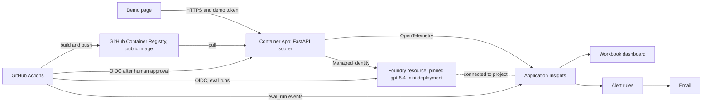

# Architecture

What runs where, who may do what, and what keeps the cost down. The design reasoning is in `intent/spec.md` section 9; this page describes what is provisioned.

## Resources

One resource group, `rg-answer-scorer-demo`, in UK South. The group and every resource that accepts tags carry `project=answer-scorer`, `env=demo`, `owner` (the public GitHub handle) and `azd-env-name`. Names that must be unique across Azure end in a short suffix that Bicep derives from the subscription, shown here as `<suffix>`.

| Resource | Name | Notes |
|---|---|---|
| Foundry resource | `aif-answer-scorer-<suffix>` | Kind `AIServices`, SKU S0, project management on, custom subdomain, system-assigned identity, key authentication disabled |
| Foundry project | `proj-answer-scorer` | Holds the Application Insights connection |
| Model deployment | `scorer-mini` | gpt-5.4-mini, version 2026-03-17, Global Standard, capacity 100 (thousand tokens per minute), `NoAutoUpgrade`, guardrail `Microsoft.DefaultV2` |
| Log Analytics workspace | `log-answer-scorer-<suffix>` | Pay per GB, 30 days retention, daily cap 0.1 GB |
| Application Insights | `appi-answer-scorer-<suffix>` | Workspace-based; connected to the project (category `AppInsights`) |
| Container Apps environment | `cae-answer-scorer-<suffix>` | Consumption profile only; container logs go to the workspace |
| Container App | `ca-answer-scorer` | Single revision mode, external ingress, HTTPS only, 0 to 2 replicas, 0.5 vCPU and 1 GiB |
| Managed identities | `id-app`, `id-deploy`, `id-eval` | See below |
| Budget | `budget-answer-scorer-demo` | On the resource group |

There is no Azure Container Registry: the deploy workflow publishes a public image to `ghcr.io`. The workbook, the action group and the alert rules are not in `main.bicep`; they are in `infra/observability.bicep`, which is deployed on its own with `az deployment group create`, never with `azd`. The SLOs, the dashboard tiles and the alert rules are described in `docs/slo.md`.

The Container App starts on a placeholder image (`mcr.microsoft.com/k8se/quickstart:latest`, port 80, no custom probes). The first deploy through GitHub Actions switches it to the real image on port 8000 and adds the probes.

## Identities

Nothing uses a key. Three user-assigned managed identities, each with one role on one resource:

| Identity | Used by | Role | Scope | Created by |
|---|---|---|---|---|
| `id-app` | The Container App | Cognitive Services OpenAI User | The Foundry resource | Bicep |
| `id-deploy` | The deploy workflow | Container Apps Contributor | The Container App only | Azure CLI |
| `id-eval` | The evals workflow | Cognitive Services OpenAI User | The Foundry resource only | Azure CLI |

The signed-in owner also holds Cognitive Services OpenAI User on the Foundry resource (assigned in Bicep), for local runs and live evals: an Owner role on a subscription carries no data actions.

`id-deploy` and `id-eval` have no secrets. GitHub Actions signs in with OIDC through federated credentials (issuer `https://token.actions.githubusercontent.com`, audience `api://AzureADTokenExchange`). The subjects use GitHub's immutable format, which names the owner and the repository together with their numeric IDs, followed by a context:

- `id-deploy`: one credential, for jobs that run in the `demo` environment. That environment needs the owner's approval, so nothing can sign in as `id-deploy` without it.
- `id-eval`: two credentials, one for pull request runs and one for runs on the `main` branch.

A workflow in any other repository presents a different subject and is refused, and so does a job in this repository that runs outside the `demo` environment and asks for `id-deploy`. `id-eval` is wider on purpose: its pull request subject does not name a branch, so a pull request run from any branch of this repository can sign in as `id-eval`. That is accepted because `id-eval` holds only the inference role, and only people with write access can push a branch here. Pull requests from forks are a separate case: their workflows wait for approval, receive no secrets and only a read-only token, and cannot request an OIDC token, so they cannot sign in as `id-eval`.

The tenant, subscription and client IDs and the Foundry endpoint are GitHub repository secrets; they appear in no file. They are secrets and not variables because the repository is public: GitHub prints the inputs and environment of a step in the job log and masks only secrets, so a variable passed to the sign-in step is shown to anyone who opens the run. No workflow reads any of the five from a variable, and a test fails if one does.

## What is set where

| Setting | Set by |
|---|---|
| Every resource above except `id-deploy` and `id-eval` | `infra/main.bicep`, provisioned once with `azd provision` |
| Container App variables `FOUNDRY_ENDPOINT`, `MODEL_DEPLOYMENT`, `MODEL_VERSION`, `AZURE_CLIENT_ID`, `APPLICATIONINSIGHTS_CONNECTION_STRING` | Bicep (none of them is a secret) |
| Role assignments for `id-app` and the owner | Bicep |
| `id-deploy`, `id-eval`, their federated credentials and role assignments | Azure CLI, after provisioning |
| `.env.local` (git-ignored), with a generated demo token and answer-hash salt | `scripts/setup_env_local.py --write` |
| Container App secrets `demo-token` and `answer-hash-salt`, and the variables `DEMO_TOKEN` and `ANSWER_HASH_SALT` that reference them | `scripts/setup_env_local.py --push` |
| GitHub repository secrets `APPLICATIONINSIGHTS_CONNECTION_STRING`, `FOUNDRY_ENDPOINT`, `AZURE_TENANT_ID`, `AZURE_SUBSCRIPTION_ID`, `AZURE_CLIENT_ID_DEPLOY` and `AZURE_CLIENT_ID_EVAL`; `demo` environment secret `DEMO_TOKEN` | `scripts/setup_env_local.py --push` |
| GitHub repository variables `AZURE_RESOURCE_GROUP`, `CONTAINER_APP_NAME`, `MODEL_DEPLOYMENT`, `MODEL_VERSION` (fixed names that identify nothing) | `scripts/setup_env_local.py --push` |

`FOUNDRY_ENDPOINT` is the scheme and host of the Foundry resource with no trailing slash. The application calls `<FOUNDRY_ENDPOINT>/openai/v1/`.

The script prints only the names of what it wrote, set or removed, never a value. `--push` also deletes any GitHub variable left under the name of one of the five identifying secrets. Provisioning `main.bicep` again removes the Container App secrets and their two variables, so `--push` must be run again after any provision. After the first application deploy `main.bicep` is not provisioned again at all, because it would also put the placeholder image and port back.

## Spend controls

The whole project has a limit of 10 GBP. A budget only warns, so the limit is kept by design:

- **Scale to zero.** The Container App runs 0 to 2 replicas on the Consumption profile, so an idle app costs nothing. Nothing has a fixed hourly or monthly charge: no container registry, no dedicated workload profile, no provisioned throughput.
- **Ingestion cap.** The Log Analytics workspace stops ingesting for the day at 0.1 GB, and keeps data for 30 days.
- **Budget.** 10 in the billing currency on the resource group, counted over a year from 1 October 2026, with emails at 50, 80 and 100 percent of actual cost. The address comes from the azd environment and is in no tracked file.
- **Model calls** are the only cost that grows with use. The deployment is pay per token, limited to 100 thousand tokens per minute, and the demo URL sits behind a demo token and a rate limit.
